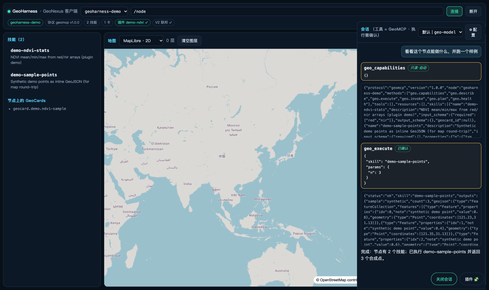

# GeoHarness

GeoNexus 的**轻客户端**：连 GeoNode、跑技能、看图、会话。

**形态**：**Web 单页应用**（Vite + Vue 3）。浏览器里跑，地图（MapLibre / Cesium）也在浏览器内渲染 —— 没有 Electron/Tauri 外壳。它可以被嵌进平台工作台（iframe 或作为 npm 包被前端引用），将来要打包成桌面端也只是加一层壳，不需要改内核。

它与 [GeoNexus-SDK](https://github.com/muyang/GeoNexus-SDK) 的关系是**纯协议关系**：客户端不 import 任何 SDK 代码，只通过 HTTP 说 GeoMCP（JSON-RPC 2.0）。因此 SDK 里只有协议与执行面，客户端单独在本仓维护。



---

## 快速开始

需要 **Node ≥ 20**。

```bash
npm install
npm run dev            # http://localhost:5175
```

开发服务器把 `/node` 代理到 `http://127.0.0.1:8787`（可用环境变量改）：

```bash
GEONODE_URL=http://192.168.100.101:8787 npm run dev
```

打开页面 → 顶部地址栏填 `/node`（走代理）或节点完整地址 → 点「连接」。

## 连不上节点？九成是 CORS

浏览器直连**跨域**节点时，节点必须显式放行本站来源 —— 这是故意的默认值（无鉴权节点不该对全网浏览器开放执行）。症状是页面报连接失败、而 `curl` 却是通的。

```powershell
# Windows / PowerShell（注意 $env: 前缀，不是 bash 写法）
$env:GEONODE_CORS_ORIGINS = 'http://localhost:5175'
python mynode.py            # 必须同一个窗口启动
# 长期生效：setx GEONODE_CORS_ORIGINS "http://localhost:5175"
```

```bash
# macOS / Linux
GEONODE_CORS_ORIGINS=http://localhost:5175 python mynode.py
```

自检（应回 `access-control-allow-origin`，而不是 405）：

```bash
curl -i -X OPTIONS http://127.0.0.1:8787/geomcp \
  -H "Origin: http://localhost:5175" -H "Access-Control-Request-Method: POST"
```

`npm install` 若报缓存目录不可写：

```bash
NPM_CONFIG_CACHE=/tmp/npm-cache npm install
```

## 三块能力

**① 地图 —— 引擎是插件**
内置 `GeoLibre · MapLibre 2D` 与 `Cesium · 3D 地球`。地图下拉里的引擎来自**已启用的渲染器插件**，在插件管理器里关掉就消失；全关会明说"没有启用的渲染器插件"而不是白屏。

**② 技能与运行**
技能列表来自节点的 `geo.capabilities`；参数表单由技能的 `input_schema` 生成（没有 properties 时退回 JSON 输入）。执行走 `geo.execute`，可选带 GeoCards / bbox / GAAG 合约绑定。产物查看器：内联 GeoJSON → 上图；CSV → 内联表格；HTML → 内联 iframe（blob）；GeoTIFF → 诚实提示"浏览器内不解码"；路径型产物经节点的受控出口 `/artifact` 取回。

**③ 会话面板（LLM）**
OpenAI 兼容端点，**多配置档**（可增删改切换 + 真实测连，错误说人话），密钥只存本机 localStorage。工具集 = GeoMCP 方法（capabilities / describe / execute / plan），浏览器内跑 tool-calling 循环（上限 4 轮）：

- 只读工具（列能力 / 看合约）**自动执行**；
- 执行类（`geo_execute` / `geo_plan`）**先展示参数，人工点确认才发出** —— 人在环。

## 一切皆是插件

内置能力本身也走插件注册表（四类：`renderer` / `panel` / `knowledge` / `viewer`），插件管理器（🧩）可启停，状态持久化：

| 插件 | 类型 | 说明 |
|---|---|---|
| `renderer.maplibre` | renderer | GeoLibre · MapLibre 2D（默认） |
| `renderer.cesium` | renderer | Cesium 3D 地球（动态 import，不依赖 Cesium ion 令牌） |
| `panel.chat` | panel | 会话面板（LLM + 人在环） |
| `knowledge.geokg` | knowledge | GeoKG 知识库：**优先用节点上市场安装的 `geokg-search` 技能，零配置即插即用**；否则退回 `geokg-api` HTTP 端点；都没有就给出安装指引 |

> 「经公共产品市场安装**客户端**插件（下载 JS 并动态加载）」尚未实现 —— 现在只插件化了内置能力；服务端平面（pip 包）已经可以经平台市场审批安装。

## 测试与构建

```bash
npm test          # node --test：协议客户端 / CSV 解析 / 插件注册表 / LLM 配置档 / 工具循环（18 项）
npm run build     # 产出 dist/（Cesium 静态资源由 prebuild 钩子拷到 public/cesium/）
```

浏览器端到端（真实点击流，headless Chrome + CDP）：连接节点 → 选技能 → 执行 → 上图；以及会话面板两轮工具调用 + 确认门 → `screenshots/`。

## 嵌入平台工作台

计划（M4）：把内核抽成 `@geonexus/client-core`（地图 + 技能 + 运行 + 查看器，不含密钥管理），平台前端以路由 `/workbench/studio` 引用并复用其登录态。

## 许可

Apache-2.0，见 [LICENSE](LICENSE)。
